<div align="center">
  

  <a href="https://git.io/typing-svg"></a>

  <p align="center">
    <b>"Turning coffee into firmware, and firmware into blinking LEDs."</b>
  </p>

  <p align="center">
    <em>
      <s>Professional LED blinker</s> Embedded Systems Engineer (promoted, allegedly)<br>
      🔌 <b>Pin-Out Whisperer</b> • 🧠 <b>Neural Nets in 264 KB of RAM</b> • ☕ <b>Coffee-to-Firmware Compiler</b><br>
      // Debugging rule #1: it's always the wiring. Rule #2: see rule #1. //
    </em>
  </p>

  <p align="center">
    <a href="https://www.linkedin.com/in/faril-pirwanhadi-6b692b2a4" target="_blank">
      
    </a>
    <a href="mailto:farilpirwanhadi1@gmail.com" target="_blank">
      
    </a>
  </p>
</div>

---

### 🧩 About Me

```c
#include <stdint.h>

typedef struct {
    const char *name;
    const char *role;
    const char *focus[4];
    const char *daily_driver[4];
    const char *buffs[3];
    const char *debuffs[3];
    uint8_t     coffee_level;   /* 0..255, mostly 255 */
    const char *motto;
} engineer_t;

const engineer_t faril = {
    .name         = "Faril Pirwanhadi",
    .role         = "Embedded Systems Engineer",
    .focus        = { "TinyML", "Reinforcement Learning", "IoT", "Intelligent Sensing" },
    .daily_driver = { "C/C++", "Python", "FreeRTOS", "ROS 2" },
    .buffs        = { "Coffee", "A working oscilloscope", "Clean ground plane" },
    .debuffs      = { "Floating pins", "Race conditions", "Magic smoke" },
    .coffee_level = 0xFF,       /* saturated, as usual */
    .motto        = "If it compiles, flash it. If it smokes, check the wiring.",
};
```

### ⚡ Currently

- 🎓 Recently defended my thesis on **edge-intelligent aquaculture monitoring**: reinforcement learning + TinyML + 5G N3IWF
- 🧠 Squeezing neural networks into microcontrollers with **TinyML**
- 🚁 Flying simulated drones with **ArduPilot + Gazebo** (no propellers were harmed)
- 💬 Ask me about **RP2040, FreeRTOS, micro-ROS**, or why your I²C bus just froze
- ⚡ Fun fact: half of my debugging is done with a single LED

### 🛠️ Tech Stack

<div align="center">

| Category | Technologies |
| :--- | :--- |
| **Languages** |       |
| **Embedded & RTOS** |       |
| **Robotics & Drones** |       |
| **AI / ML** |      |
| **Backend & Data** |    |
| **Frontend & Apps** |       |
| **Networking & Security** |    |
| **Tools & Testing** |      |

</div>

---

### 🚀 Featured Projects

<table>
  <tr>
    <td width="50%" valign="top">
      <h4>🐟 <a href="https://github.com/latverian/edge-intelligent-aquaculture">Edge-Intelligent Aquaculture Monitoring</a></h4>
      <sub>🎓 thesis · showcase</sub>
      <p>Predicts toxic-ammonia (NH₃) risk from just pH + temperature with a progressive <b>Rule → FQL → DQN</b> pipeline. The DQN trains on a Raspberry Pi 5 and is distilled into a ~5 KB Q-table that a Pico runs in O(1), with every node linked through a <b>5G N3IWF</b> local edge hub.</p>
      <sub><code>C</code> <code>Python</code> <code>RP2040</code> <code>RL</code> <code>5G N3IWF</code></sub>
    </td>
    <td width="50%" valign="top">
      <h4>🔐 Post-Quantum Crypto on RP2040</h4>
      <sub>🔒 private</sub>
      <p><b>CRYSTALS-Kyber512</b> (NIST ML-KEM, FIPS 203) on a $4 microcontroller: a self-test and benchmark at ~6 ms per KeyGen + Encaps + Decaps cycle, plus an encrypted Pico ↔ PC chat over USB serial.</p>
      <sub><code>C</code> <code>Pico SDK</code> <code>Python</code> <code>Cryptography</code></sub>
    </td>
  </tr>
  <tr>
    <td width="50%" valign="top">
      <h4>🌱 <a href="https://github.com/latverian/RPIPICO_AGRICULTURE">TinyML Smart Farming</a></h4>
      <sub>RPIPICO_AGRICULTURE</sub>
      <p>Two <b>int8-quantized neural networks</b> (TensorFlow Lite Micro) decide fan and pump levels from DHT11 temperature/humidity plus an analog sensor, all running on a Raspberry Pi Pico.</p>
      <sub><code>C++</code> <code>TFLite Micro</code> <code>FreeRTOS</code> <code>RP2040</code></sub>
    </td>
    <td width="50%" valign="top">
      <h4>💸 <a href="https://github.com/latverian/kantong">Kantong</a></h4>
      <sub><a href="https://kantong-p1k2.vercel.app">live demo</a></sub>
      <p>A <b>local-first money manager PWA</b> for juggling Rupiah and New Taiwan Dollar: a daily-interest engine, cross-currency transfers, offline-first storage, and a strict CSP with an attack simulation running in CI.</p>
      <sub><code>React 19</code> <code>TypeScript</code> <code>Vite</code> <code>IndexedDB</code></sub>
    </td>
  </tr>
  <tr>
    <td width="50%" valign="top">
      <h4>📷 <a href="https://github.com/latverian/openmv">OV7670 × RP2040 Camera</a></h4>
      <sub>openmv</sub>
      <p>Camera capture with <b>PIO + DMA</b> through a 74HC165 shift register (just 2 GPIOs for 8 data bits), printing each frame as ASCII art over USB serial.</p>
      <sub><code>C</code> <code>PIO</code> <code>DMA</code> <code>Pico SDK</code></sub>
    </td>
    <td width="50%" valign="top">
      <h4>🤖 <a href="https://github.com/latverian/micro_ros_assignment">BlinkSynk: FreeRTOS × micro-ROS</a> · <a href="https://github.com/latverian/blink_synk_ros2">ROS 2 port</a></h4>
      <p>FreeRTOS tasks synchronized with semaphores on a Pico, publishing their state to <b>ROS 2 Humble</b> via micro-ROS (XRCE-DDS), plus a pure ROS 2 C++ port of the same pattern.</p>
      <sub><code>C</code> <code>C++</code> <code>FreeRTOS</code> <code>micro-ROS</code> <code>ROS 2</code></sub>
    </td>
  </tr>
</table>

---

### 📊 GitHub Stats

<div align="center">
  
  
</div>

---

### 👾 Pac-Man Ate My Commits

<div align="center">
  <picture>
    <source media="(prefers-color-scheme: dark)" srcset="https://raw.githubusercontent.com/latverian/latverian/output/pacman-contribution-graph-dark.svg">
    <source media="(prefers-color-scheme: light)" srcset="https://raw.githubusercontent.com/latverian/latverian/output/pacman-contribution-graph.svg">
    
  </picture>
</div>

---

<div align="center">
  
</div>

---

<div align="center">
  
  <br><br>
  
</div>
